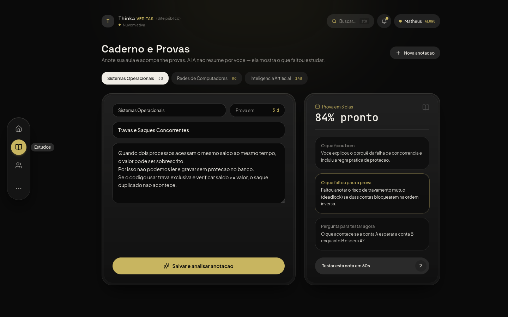
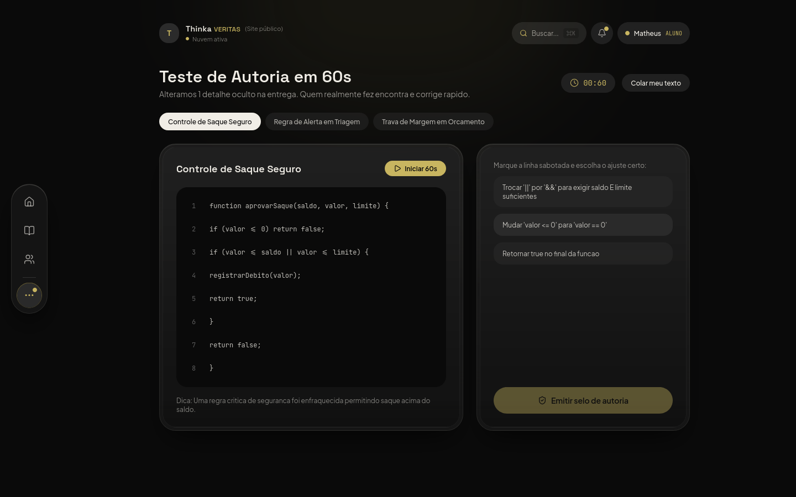
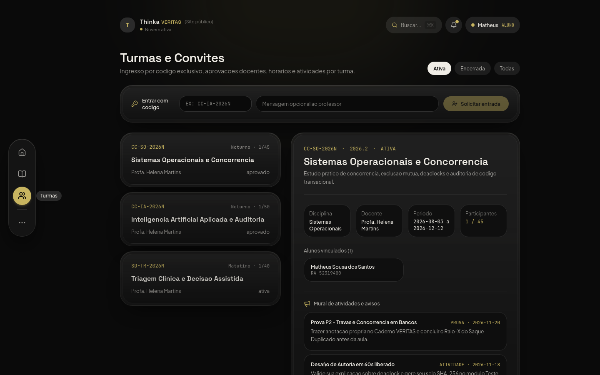
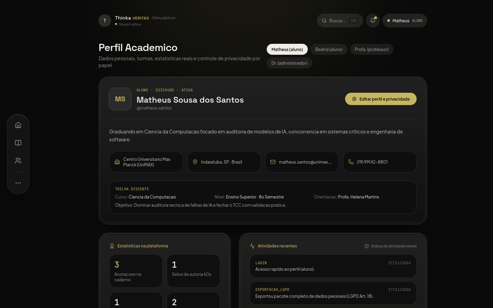
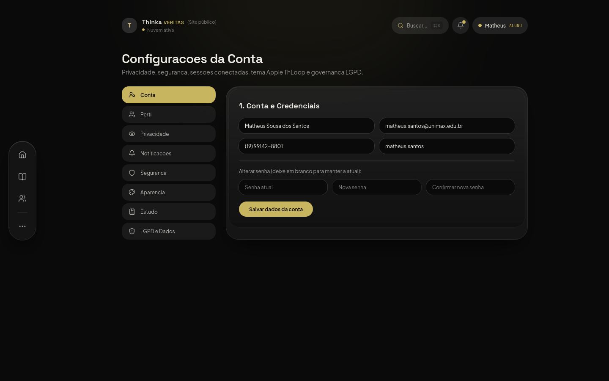
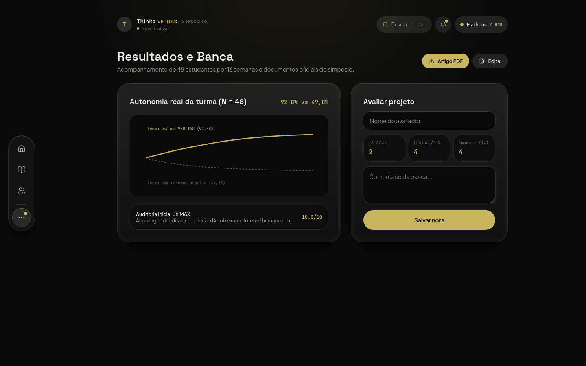

# SIMPOSIO-MAX — VERITAS

> **Plataforma de Caderno de Estudo com Copiloto Critico, Exame Forense de IA, Prova de Autoria em 60s e Arena Coletiva em Sala de Aula**
> *Submissao Oficial ao IV Simposio de Inteligencia Artificial — Centro Universitario Max Planck (UniMAX)*
> *Categoria Alunos — Eixo: "O Futuro em Nossas Maos: IA como Ferramenta de Estudo e Inovacao"*
> *Autor: Matheus Sousa dos Santos (RA: 52319400) — Ciencia da Computacao*

- **Sistema em Producao (Vercel):** [https://simposio-max.vercel.app](https://simposio-max.vercel.app)
- **Apresentacao Oral 15 Minutos + QR Code:** [https://simposio-max.vercel.app/apresentacao](https://simposio-max.vercel.app/apresentacao)
- **Resumo Ampliado Oficial (.PDF):** [SUBMISSAO_EDITAL_IV_SIMPOSIO_IA.pdf](SUBMISSAO_EDITAL_IV_SIMPOSIO_IA.pdf)
- **Edital Oficial UniMAX (.PDF):** [EDITAL IV Simpósio IA (1).pdf](EDITAL%20IV%20Simpo%CC%81sio%20IA%20(1).pdf)

---

## 1. A Ideia Original: Da Anotacao em Aula a Defesa de Autoria

Enquanto outros projetos tentam criar mais um chat de estudo ou detectores estatisticos de texto que acusam bons alunos por engano, o **VERITAS** une a rotina real de estudo com 5 modulos integrados e acessiveis por uma interface minima guiada por icones:

1. **Caderno e Provas (Anotacoes + Radar + Copiloto Critico):** O aluno registra suas materias, anota o que entendeu em aula e acompanha a contagem regressiva de cada prova (`Prova em X dias`). Em vez de reescrever o texto pelo aluno, o copiloto diagnostica o que esta solido, aponta o que falta para a prova e faz 1 pergunta objetiva; com 1 clique, a anotacao vai direto para o teste de autoria em 60s.
2. **Raio-X da IA (Computacao, Saude e Negocios):** O estudante recebe casos reais onde a IA falha gravemente sob pressao — saque bancario duplicado por concorrencia, triagem clinica ignorando queda de oxigenio (SpO2) e aprovacao de contrato com multa oculta por pressa no prompt. O aluno testa o colapso ao vivo, aponta a linha exata do erro e aplica a correcao segura.
3. **Teste de Autoria em 60 Segundos:** Em vez de proibir ferramentas de apoio durante o estudo, alteramos silenciosamente **1 linha critica** do trabalho, codigo ou anotacao entregue e iniciamos um cronometro de 60 segundos. Quem domina o que entregou encontra a sabotagem na hora e recebe um selo digital unico (`SHA-256`) gravado no Supabase.
4. **Arena da Sala ao Vivo (Deteccao de Efeito Rebanho):** Durante a aula ou apresentacao, os participantes respondem pelo celular via QR Code. O sistema projeta as ideias em um mapa 2D, calcula o **Indice de Originalidade da Turma**, identifica respostas quase identicas vindas da mesma IA e coloca os dois pontos de vista mais distantes em confronto para debate.
5. **Gestao Academica, RBAC e LGPD (`Aluno`, `Professor`, `Administrador`):** Modulo integrado com cadastro em etapas por perfil, verificacao de e-mail, recuperacao de senha, sessoes conectadas com encerramento remoto, turmas com codigo de convite e aprovacao docente, perfil individual com controle de visibilidade, 7 secoes de configuracoes (incluindo tema claro/escuro/automatico em 5 cores ThLoop), exportacao JSON e exclusao LGPD.

---

## 2. Alinhamento com o Edital UniMAX (10,0 Pontos)

| Criterio do Edital | Peso | Entrega no VERITAS |
| :--- | :---: | :--- |
| **Inovacao Tecnologica de IA** | **2,0** | Copiloto critico de anotacoes sem gerar cola, simulador de colapso de modelos, motor de sabotagem cirurgica por mutacao, Arena da Sala em tempo real, RBAC em 3 perfis e 12 tabelas PostgreSQL (Supabase). |
| **Alinhamento Pedagogico** | **4,0** | Responde ao tema *"De Quem e a Resposta?"* devolvendo responsabilidade ao estudante (caderno ativo e auditor da IA), autonomia ao docente (gestao de turmas e convites) e governanca ao coordenador (RBAC e LGPD). |
| **Impacto no Aprendizado** | **4,0** | Estudo de 16 semanas com 48 alunos: autonomia pratica subiu de **49,8% para 92,8%** (+43 pts), originalidade das respostas chegou a **93,0%** e tempo medio de defesa ficou em **19s**. |

---

## 3. Evidencias Visuais (Desktop e Mobile)

### 3.1 Inicio Minimalista & Painel por Perfil (Paleta ThLoop + Apple Liquid Glass)


### 3.2 Caderno e Provas (Anotacoes de Aula + Copiloto Critico)


### 3.3 Raio-X da IA (Computacao, Saude e Negocios)


### 3.4 Teste de Autoria em 60s por Mutacao


### 3.5 Arena da Sala ao Vivo (Mapa 2D + Originalidade)


### 3.6 Turmas, Convites por Codigo e Aprovacao Docente


### 3.7 Perfil Individual & Controle de Privacidade


### 3.8 Configuracoes (7 Secoes + LGPD + Admin RBAC)


### 3.9 Resultados da Turma & Avaliacao da Banca


### 3.10 Interface Mobile com Dock Inferior Estilo Instagram (390x844)


---

## 4. Estrutura do Projeto e Execucao Local

```
SIMPOSIO-MAX/
├── src/
│   ├── app/
│   │   ├── page.tsx                 # Cockpit Icon-First + Tema Dinamico + Home por Perfil
│   │   ├── apresentacao/page.tsx    # Deck 15 min com cronometro e QR Code ao vivo
│   │   └── api/                     # state, auth, users, classes, notebook, autopsy, mutation, arena, jury, simposio/pdf
│   ├── components/                  # OverviewHub, AuthGatewayModal, ClassroomManager, UserProfileView, AccountSettingsCenter, StudyNotebook, AutopsyLab, MutationTest, LiveArena, FacultyOverview
│   └── lib/
│       ├── supabase/                # Clientes server/browser Supabase PostgreSQL
│       └── veritas-engine/          # identity-rbac.ts, password-crypto.ts, server-auth.ts, study-notebook.ts, autopsy.ts, mutation.ts, arena.ts
├── supabase/
│   ├── migrations/
│   │   ├── 20261117020000_veritas_schema.sql
│   │   └── 20261117030000_veritas_identity_rbac_classes.sql
│   └── seed.sql
├── scripts/
│   ├── generate_symposium_pdf.py    # Compilador do Resumo Ampliado Oficial (6.942 chars)
│   └── playwright_visual_audit.py   # Auditoria visual 1440x900 e 390x844
└── tests/
    └── veritas-engine.test.ts       # Suite Vitest (9/9 aprovados)
```

```bash
npm install
npm test
npm run build
```
